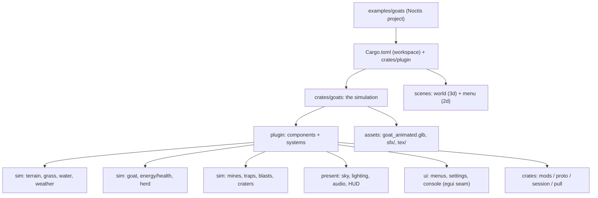

# Porting Slag Goat to Noctis

The plan for bringing **goats** (`goats/`), a JavaScript-driven 3D goat sandbox,
onto the engine as a Noctis **project**: a Rust plugin that owns the simulation,
scenes for the world, and the game's own assets. The goal is the same game — or
one close enough to read as the same — running in a Noctis window. This document
is the contract for that port; the engine features it depends on are designed in
[`.notes/animation.md`](animation.md) (skeletal animation),
[`.notes/shaders.md`](shaders.md) (the shader seam) and [`.notes/ui.md`](ui.md)
(the screen-UI seam). **M0 (the render-path spike), M1
(locomotion), M2 (the world sim), M3 (hazards), M4 (the herd), M5 (presentation)
and M6 (the menus) are largely shipped** as `examples/goats`; what remains inside
them (day/night lighting, tier-2 water reflections, the mods screen) and M7–M9 are
not. The port's test harness — the headless driver and its
seed/observe seams — is designed in [`.notes/harness.md`](harness.md).

Background: a Noctis *project* carries Rust as a plugin
([`.notes/embedding.md`](embedding.md)); its manifest and asset model are
[`.notes/project.md`](project.md); the frozen `math`/`ecs` contract is
[`.notes/core-api.md`](core-api.md).

## Decisions

1. **Animation is an engine feature, not a plugin one.** The goat is a skinned,
   fifteen-bone rig with fourteen clips; the engine has no skinning today.
   [`.notes/animation.md`](animation.md) designs it — GPU skinning, an `Animator`
   component, glTF clips and skins as assets.
2. **A custom-shader seam is added**, general enough for the sky and the water,
   rather than dropping the game's look for the engine's. (See "The shader seam".)
3. **Menus are egui, not 2D scenes.** Main / settings / mods / keymap map one to
   one onto egui widgets; the console is a text field. The engine gains a small
   screen-UI seam for a plugin to draw egui. (See "The screen-UI seam".)
4. **Single-player sandbox first; P2P multiplayer and voice follow.** The
   networking crates are pure Rust and reusable, but the port ships the sandbox
   it can stand behind before the transport work.
5. **The simulation is Rust systems, not JavaScript.** The original scene is
   ~13,500 lines of flat, shared-scope JS driving per-frame work (grass, water,
   the herd, the devices). It ports to components and systems; JavaScript stays
   only where it is genuinely gameplay-authorable, never on the hot loop.

## What goats is

| Layer | Path | Size | What it is |
| --- | --- | --- | --- |
| JS scene | `goats/crates/goats/src/game/*.js` | ~13,500 lines | the game: goat state machine, terrain, grass, water, weather, sky, food, bots, mines/blasts, menus, console, mods, net |
| Rust host glue | `goats/crates/goats/src/{lib,net,audio}.rs` | ~4,300 lines | Slag+raylib install, asset embed, the JSON `goats` host API, mod orchestration, the tokio session bridge, cpal/Opus voice |
| Pure-Rust crates | `mods`, `proto`, `session`, `pull`, `plugin`, `server` | ~10,300 lines | mod loader, wire protocol, iroh P2P session, mod sync, compiled-mod host, headless `goatsd` |
| Assets | `goat_animated.glb`, `sfx/`, `tex/`, `goat.blend` + `tools/` | — | the rigged goat (14 clips, embedded textures), audio, fleece textures |

`crates/goats/src/main.rs` is a thin host; the game is `context.eval(SCENE)`, with
the engine calling `goats_frame` (`goats/crates/goats/src/lib.rs:1177`) each frame.

## The reuse boundary

- **Directly reusable, engine-free.** `mods` (discovery, manifest validation,
  ordering, asset reads), `proto` (message types, framing, the packed `wire`
  codec), `session` (iroh transport, tickets, the join handshake, the roster),
  `pull` (host-mod sync), `plugin` (the compiled-mod host) — ~9,700 lines that
  drop into the port's plugin as path dependencies. `server`'s headless host
  becomes "run the Noctis sim with no window", which the engine already does
  (`noctis run --headless`).
- **Port, don't reuse.** `lib.rs` / `net.rs` / `audio.rs` are mostly
  binding-install and JSON-bridge glue the Noctis runtime replaces. The *logic*
  ports: mod orchestration, the session bridge, the voice speech-gate and Opus.
- **Reimplement.** The ~13,500-line JS scene. It is one flat scope over a bespoke
  `rl` / `goats` API; Noctis scripts are per-entity with a different surface.
  This is the bulk of the work.

Two-thirds of the Rust is reusable; essentially none of the JS is.

## Capability map

| goats needs | Noctis today | Disposition |
| --- | --- | --- |
| Skinned, animated glTF goat | import is static; no skins or animations | **Add** — [`.notes/animation.md`](animation.md) |
| Runtime terrain / water / grass / FX meshes | `Mesh` / `Vertex` public, `AssetRegistry.meshes.insert` | works; a rebuild helper in the plugin |
| Per-vertex terrain materials | `Vertex` has no colour | **Small add** — `Vertex::color`, `Material` opts in (see below) |
| Volumetric sky, water, custom lit look | no shader seam | **Add** — "The shader seam" |
| Water reflections (sky/ground/mirror) | engine has shadow maps, no user render targets | tiers 0/1 shipped on the seam; tier 2 needs the planar pass — [`.notes/reflections.md`](reflections.md) |
| Physics over the heightfield | rapier3d, `ColliderShape` is box/ball/capsule/cylinder | reimplement the original's `terrainHeight` sampling in a system; a heightfield collider only if rapier is actually wanted |
| raygui menus / settings / mods / keymap / console | `AppDriver::ui` draws `screen_text`; the screen-UI seam is shipped ([`.notes/ui.md`](ui.md)) | **Build the menus** on the `Ui` seam |
| HUD bars/text | `ctx.screen_text` + the `Ui` overlay | ships as `screen_text`, upgraded with the menus |
| Mods and P2P sessions | engine `extensions` are editor-only; scripting is per-entity JS | reuse the Rust crates; rebuild the scene-side glue |
| Day/night sun and shadows | IBL + one shadow-casting directional light + SSAO | maps onto the engine's light and shadow |

The goat's animation is the gating gap; the shader seam and the UI seam are the
next two, and both are bounded.

## The engine features this needs

A running list of what the engine still lacks — reflections, scene depth, frame
sun/weather, billboards, the UI seam — with the port's stopgap for each, is
[`.notes/engine-gaps.md`](engine-gaps.md).

### Skeletal animation — [`animation.md`](animation.md)

**Add** — see [`.notes/animation.md`](animation.md). The goat loads and draws at
bind pose in phase 1, and animates from phase 3.

### The shader seam

**Add.** A `Shader` asset carrying WGSL (a vertex + fragment entry point) against a
**fixed** bind-group contract the engine supplies — frame uniforms (camera view /
projection, time, sun direction and colour, weather), per-object uniforms (the
model matrix and object params), an array of texture handles, and a user uniform
block of floats — so no plugin controls layouts or bindings, only values and
shaders. A `ShaderMaterial` asset pairs a `Shader` with its textures, uniforms,
alpha mode and culling, and a `ShaderMeshRenderer` draws a mesh with it. A
second, full-screen form (`ScreenShaderMaterial` on an entity) runs a fragment
pass over the target before the scene, which is what the sky is.

For the goats look, in order: (1) the **sky** as a full-screen pass reading the
engine's camera basis, time, sun and weather; (2) the **terrain** as a lit,
vertex-coloured mesh (below); (3) the **water** as a translucent mesh with the
seam's uniforms — reflections are a later tier. Each is ordinary engine work on
top of one seam, and the seam has [its own note](shaders.md).

### The screen-UI seam

**Shipped** ([`.notes/ui.md`](ui.md)). Today the runtime's `AppDriver::ui` paints
only `screen_text` (`crates/runtime/src/window.rs`); a plugin has no way to draw a
widget. The engine gained a small, egui-free `Ui` seam: `ecs::ui` defines a `Ui`
trait with the handful of widgets the game needs (panel, label, button, toggle,
slider, combo box, text field), `EngineContext::ui` holds an optional boxed `Ui`
callback a plugin installs, and the host implements the trait over its egui
context (`platform::EguiUi`). Keeping the trait in `ecs` and the implementation in
`platform` is what lets a plugin (a `noctis` consumer) draw a menu without `ecs`
depending on egui, and lets a headless test drive a recording `Ui`
(`ecs::ui::RecordingUi`) — the same "engine owns the seam, the host renders it"
shape as `screen_text` and `FrameImage`. The menus themselves are next.

The goats screens become systems: `uiScreen` state, a system that draws the
active panel through the seam, and the existing `SETTINGS` / `TUNING` writes
behind it.

### Vertex colour (shipped)

`Vertex` carries `color: [f32; 4]` (default white), uploaded at shader location 6 —
clear of the skin buffer's 4 and 5 — and a `Material` flag, `vertex_colors`,
multiplies the shaded base colour by it. The terrain authors its grass / sand / rock
per vertex (`examples/goats/crates/goats/src/terrain.rs`), from slope and height
rather than a blend map; a fourth blend weight for a detail texture is still open.

### Ground collision

The original never uses a physics engine: it samples a pure `terrainHeight(x, z)`
function and does its own goat/herd/device collision. **Reimplement that** as a
plugin system over the same noise function, not as a rapier heightfield — the
plugins' bodies are few and the function is the source of truth for rendering the
ground too. rapier stays for shoving the herd if a body is wanted.

## The shape

## Milestones

Single-player sandbox first; each milestone is playable.

1. **M0 — render path.** *(Shipped in `examples/goats`.)* The goat model loads
   as a static mesh, the terrain mesh is built from the original's own noise
   function, and an orbit camera frames it with a HUD line. It needed one engine
   addition: the importer now accepts and applies a glTF material's
   `KHR_texture_transform` (the goat's fleece is atlas-packed at 6×), which is
   where the single-UV limitation is recorded.
2. **M1 — locomotion.** *(Shipped in `examples/goats`.)* The goat's state machine
   — idle, the three gaits, a jump and sleep — over the engine's skeletal
   animation. The eat, flung and dead states arrive with the milestones that
   cause them (M2's food and energy, M3's blasts).
3. **M2 — world sim.** Grass grazing, energy/health, weather state machine, water
   pooling, food. *(Shipped: the meadow — the procedural grass field and grazing
   it (the eat action, the belly, regrow) — the health/energy system with
   exhaustion, death and restart, the weather state machine with its rain/wind
   slowdown and wetter drain, and the water table: the rain fills it, it slows and
   drains a wading goat, hides the tufts it stands over and refuses to let the goat
   sleep in a pool. The weather's clouds, rain streaks and sky tint, and the water's
   surface, wake and splashes, are the presentation layer (M5); the table's own
   `flood` console verb arrives with the console, M6.)*
4. **M3 — hazards.** *(Shipped in `examples/goats`.)* Mines and trapped tufts are
   *derived* from a per-cell hash (nothing stored), trip when the goat comes within
   0.6 m, go on a 0.18 s fuse, and blow: damage with a falloff and a floor (a mine
   cannot end the run), a ballistic arc that dishes a crater into the ground, and a
   one-level chain into neighbours. The crater is a term in the ground's height, so
   the goat, the camera, the grass and the water all stand in the hole, and it heals
   over four minutes. The bang's *look* — the fire/smoke atlases, the debris, the
   flash light, the camera's knock and the red damage pulse — is the presentation
   layer (M5). *(The flash light, the camera's knock and the fire / smoke / grit
   have since shipped, M5; the red damage pulse remains.)*
5. **M4 — herd.** *(Shipped in `examples/goats`.)* Seven bot goats (`TUNING.herd.count`)
   roam around the player on the original's state machine — graze, stroll, trot,
   occasionally sprint and hop, rarely doze — each with its own size, temperament
   (`TUNING.herd.spec`) and generated fleece (`makeBotTextures`: a coat-tinted
   value-noise image its material wears, so the herd reads as individuals), its own
   node hierarchy and animator, but sharing the goat's meshes, skin and clips. They
   eat the meadow, are slowed by the rain, are steered home when they stray and
   pushed apart so no two goats overlap. They trip the devices they walk over
   (`updateExplosions` runs `checkTriggers` for every bot, and a bot that grazes a
   trapped tuft blows it too), and a bang **damages, flings and can kill** them —
   the player's own curve without the player's health floor — after which a bot lies
   dead for `herd.deathLinger` seconds and gets up somewhere else.
6. **M5 — presentation.** *(Shipped: the sky — a `ScreenShaderMaterial` over the
   engine's shader seam, a view ray plus a gradient and sun, tuned through the
   material's `user` block and animated there: the sun arcs and the colour drains
   toward grey in rain; the seam's contract is [`.notes/shaders.md`](shaders.md).)*
   **Audio** has since shipped — the engine's `AudioEngine` (rodio on native, the
   browser's WebAudio on `wasm32`) plays the original's own samples: looping
   music, the rain and wind beds tied to the weather, goat bleats, and blasts
   attenuated by distance from the goat. Day/night lighting still follows; the
   **terrain** carries per-vertex
   grass / sand / rock through the engine's vertex colour, and the **water** is a
   translucent surface drawn through the seam's mesh form. The **bang** has its
   flash — one shadowless point light that flares at a blast and decays — a camera
   knock from the bangs that reached the goat, and fire, smoke and grit drawn as
   billboards whose atlases are generated at boot (the engine's billboard path,
   [`.notes/billboards.md`](billboards.md)); an armed mine in reach shows its
   "tell". The weather's clouds drift and its rain falls, both as billboards. The
   **meadow** leans on the wind through the shader seam (the sway weight rides in
   the vertex colour). The water **reflects** the sky and a baked ground (tiers 0
   and 1 of [`.notes/reflections.md`](reflections.md)); tier 2, a planar mirror of
   the whole scene, waits on the engine's pass.
7. **M6 — UI.** *(Shipped: the menus.)* On the screen-UI seam
   ([`.notes/ui.md`](ui.md)): the **main menu** (Continue/Play, Restart, Settings,
   Keymap, Console, Quit), **settings** (volume, mute, the water, a weather
   button), the **keymap** table, and the **console** (`help`, `weather`, `flood`,
   `water`, `restart`, `mute`, `volume`, `clear`, `quit`). A screen freezes the
   world and the game's input, as the original's `uiScreen` does; `Esc`/`P` opens
   it, `Enter` runs the console line. The **mods** screen waits on M7.
8. **M7 — mods.** Reuse the `mods` crate; re-expose a `goats`-style host API.
9. **M8 — multiplayer and voice.** Reuse `session` / `proto` / `pull`; rebuild the
   scene-side sync and the voice path.
10. **M9 — fidelity and perf.** Match the frame budget and the look.

## Rejected alternatives

- **Keep the JS loop and shim `rl` onto the engine.** The engine has no `rl`, and
  the scene drives per-frame work JS cannot afford; a shim would be a slower,
  second engine.
- **Menus as 2D scenes.** More work than the seam for the same result, and the
  screens are data, not art.
- **A rapier heightfield for the ground.** The simulator's ground is a function,
  not a mesh; sampling it keeps one source of truth for physics and render.
- **Dropping the custom look for the engine's.** The volumetric sky and the water
  are the game's signature; the shader seam is the smaller cost.

## What already exists

- The plugin seam, the component registry, and scene-authorable Rust
  ([`.notes/embedding.md`](embedding.md)) — the port's shape.
- Runtime mesh and texture registration: `Mesh` / `Vertex` are public and
  `AssetRegistry.{meshes,materials,textures,audio,fonts}` accept inserts, so all
  procedural geometry and generated textures are reachable.
- glTF import (`render::load_gltf_bytes`) and `LoadedGltf::instantiate`, the seam
  animation extends.
- `screen_text` and `FrameImage` — the "host draws what the driver publishes"
  precedent the UI seam follows.
- rapier3d for anything a body is genuinely wanted for.
- The goat's own assets and the pure-Rust crates above, unchanged.

## Phasing

The milestones *are* the phasing; the engine work inside them is:

1. **Animation import** → **skinned draw** → **playback**
   ([`animation.md`](animation.md)).
2. **Vertex colour** (small, unblocks the terrain in M0/M2).
3. **The shader seam** (M5), then sky → terrain → water.
4. **The screen-UI seam** (M6).
5. **Mods** (M7) and **multiplayer/voice** (M8) as the pure-Rust crates land.

## Graphics gaps seen in play

The port runs with the original's controls and behaviour; these are the known
visual shortfalls, to take up under M5/M9 or the engine work they name. They are
deliberately deferred — the systems come first.

- **The goat reads grey.** Its fur texture is applied (and, since the importer
  fix, its normal and metallic-roughness maps too), but the placeholder sky's
  neutral ambient washes the colour out. A real sky (M5) is the fix; the fur's
  sRGB handling and filtering are worth a look at the same time.
- **The grass tufts read as thin sticks**, not the original's two stacked cubes.
  The sizes and segments match `tuftField`, so this is a look/scale question (the
  0.14-unit cube against the view distance) rather than the field maths.
- **The weather's look is in** (M5): clouds and rain as billboards, the sky tint,
  the water surface, and the grass swaying on the wind through the shader seam.
- **The bang's look is complete** (M5): the flash light, the camera knock, the
  fire / smoke / grit billboards, the red damage pulse, and the mine "tell". The
  crater *is* drawn — it is a term in the ground's height, so the dished terrain
  mesh shows it.

## Open questions

- **Where the goat model lives.** `examples/goats` can carry its own
  `goat_animated.glb` and `sfx/`, or reference the source repo's. A self-contained
  project with its assets under `content/` is the likely answer; the ~10 MB
  ambience beds favour loose files until bigger assets are packable
  ([`.notes/scripts.md`](scripts.md)).
- **Vertex colour vs. a blend texture.** Recommended above; revisit if the
  vertex-layout change costs more than expected.
- **How much of the herd's AI stays data.** Seven bots with temperaments are
  plausibly a component plus a system; a script is possible but not needed.
- **Blend trees.** The goat switch-clips today; cross-fade is a consumer's need,
  not an engine requirement ([`animation.md`](animation.md), open questions).
- **Scope of M5's sky.** The volumetric raymarch is a shader the seam enables but
  does not design; its step count and quality tiers are the port's call.
