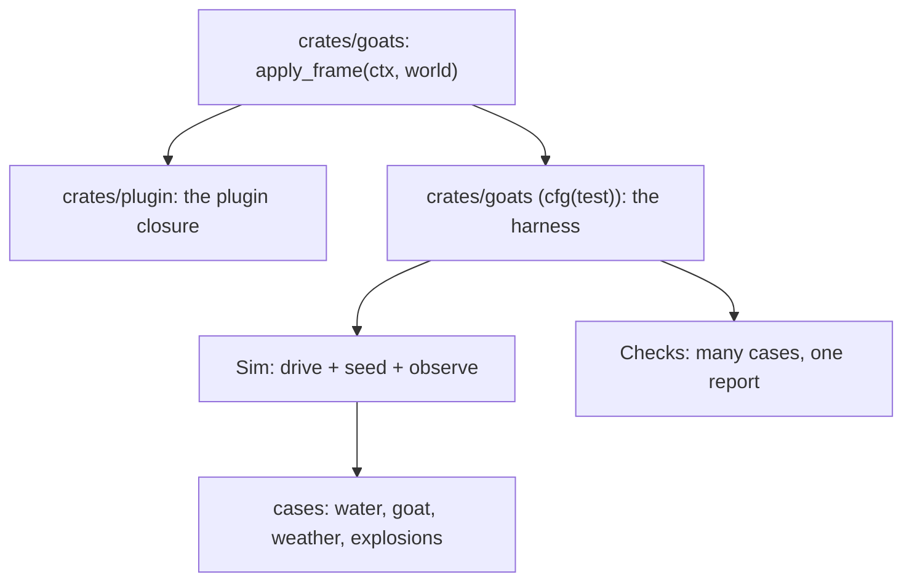

# The goats harness

The port's tests are unit tests in each simulation module plus a handful of
`App`-driven integration tests. The original keeps something bigger and sharper:
a **scene harness** (`goats/crates/harness`) that drives the *whole game*
headlessly and asserts, case by case, on what the run produced. This note is the
contract for bringing that to the port — the same **method**, not the same
machinery. It is the test counterpart to [`.notes/goats.md`](goats.md).

**Shipped.** `crates/goats` carries the harness as a `#[cfg(test)] mod harness`:
`mod.rs` (the `Sim` driver and the `Checks` reporter) beside `water.rs`, `goat.rs`,
`explosions.rs` and `weather.rs` — 17 cases that drive `spawn_world`/`apply_frame`
directly, no `App` and no plugin. The sections below are the design it realises.

## What the original harness is

`goats/crates/harness` evaluates the client's **JavaScript scene** on the Slag
engine against two fake raylibs — `scene::NULL_RL` (every call a no-op) and
`scene::HARNESS_RL` (a recording stub) — so the tests need no Node, no raylib and
no display, yet run the *real* scene: a binding the engine lacks fails a test
instead of passing one. `Harness::run(frames)` drives the scene's own `run()`
loop once and returns one JSON blob of `Observations`; anything the scripted
run does not cover is then driven through `command`/`call`/`eval`, exactly as the
host and the old Node harness did (`command("flood 0.3")`, `eval("rainAmount = 1")`,
`call("waterStep", [1e6])`).

A test records many fine-grained cases with a `Checks` reporter
(`tests/support/mod.rs`) and fails once at the end, printing every case — a long
run is not thrown away at the first miss. Coverage is broad: `scene_logic.rs` is
~3,400 lines (one 1,300-line scripted timeline plus ~40 explosion checks, help,
net, chat, sync and gaits), `water.rs` ~20 cases, and `celestial`, `birds`,
`skinning`, `console`, `mods`, `touch`, `wasm_mod`, `es3`, `plugin_abi`,
`plugin_bench` and `observations` beside them.

## Why the machinery does not port

It is a *JavaScript* scene harness. There is no JS scene in the port, and no
raylib to record — the port's simulation is Rust systems over the engine's ECS.
So `Harness` itself, the recording `rl`, and the `scene` crate it evaluates are
all out. What is *not* out is the idea, and most of the cases.

The port's equivalent is a headless driver over the port's own simulation, with a
**seed seam** (to place the goat, set the rain, force a level — the original's
`pos`/`rainAmount`/`flood`) and an **observe seam** (to read the level, the
depth, the goat, the HUD — the original's `sceneWater()`/`waterDepthAt`/HUD
lines). Because the port's simulation is Rust, the observe seam reads **typed
Rust** rather than a JSON string — the same seam, a better one.

## What ports, and what does not

- **Ports:** the approach (drive, seed, observe, `Checks`) and the *scene-level*
  cases — the goat wades and will not sleep in a pool, a blast flings it and
  dishes a crater, the meadow culls what the ground swallowed, the HUD reads
  right.
- **Already covered:** the *pure-logic* cases (the level is monotone in the rain,
  a dry spell is exactly dry) are unit tests in `water.rs`/`terrain.rs`; the
  harness earns its keep on whole-scene, scripted-input behaviour, so the two do
  not duplicate each other.
- **Does not port:** `es3`/`plugin_abi`/`console`/`mods`/`touch`/`wasm_mod`/`net`
  — those are the console (M6), mods (M7) and net (M8), and the JS-runner cases
  test an engine the port does not have. The **draw counters**
  (`billboardRecs`, `modelsDrawn`, …) have no analogue without a recording
  renderer; the port's version of that seam is the shader seam (M5) or the
  renderer's own counters, and lands with it.
- **Deliberate difference:** the original's terrain *follows the goat* (its grid
  slides, and `water.rs` has whole cases proving the water is the same in every
  window). The port's terrain is **fixed** (`.notes/goats.md`, "Graphics gaps"),
  so those cases do not exist — a window is not a concept. The harness records
  this rather than porting the cases.

## The shape

## The design

### The frame seam

The plugin's per-frame body — weather, water, the goat, the hazards, the
ground/meadow rebuilds, the camera and the HUD — lives in one function,
`apply_frame(ctx: &mut EngineContext, world: &mut World)` in the `goats` crate,
that **both** the plugin's `on_update` closure and the harness call. The plugin
closure (in `crates/plugin`) is a two-line owner of the `World`; the camera's
orbit state lives in `World`, so the function is self-contained. This is the whole
of what makes the simulation drivable: one entry point, no `App` required.

### `Sim`

A `#[cfg(test)] mod harness` with a `Sim` that owns an `EngineContext` and a
`World`:

- **Drives.** `step(dt)` is a three-line `App::tick`: `time.advance(dt)`, then
  `apply_frame`, then `input.begin_frame()` — so per-frame key edges behave
  exactly as they do under the real loop, without surrendering the `World` to a
  closure. `run(frames)` loops it.
- **Seeds.** Input by hand (`press`/`release`/`key`/`mouse`/`scroll`), and the
  state the original set through its console and `eval`: `place_goat(x, z)`,
  `set_rain(a)`, `force_level(h)`/`clear_level()`, `drop_crater(x, z)`. The last
  three are a few `#[cfg(test)]` setters on `Weather`/`Water` — the seed seam,
  and the port's stand-in for the original's `sceneUseSeed`-shaped hooks.
- **Observes.** Typed accessors — `goat()` (mode, position, health, energy,
  satiety, and the fling state), `water()` (level, wetting, `depth_at`),
  `craters()`, `meadow_verts()`/`terrain_verts()` (through the asset registry),
  and `hud()` (the two `screen_text` lines).

### `Checks`

Copied from the original's `tests/support/mod.rs`: a test records cases as it
goes and `finish()` prints them all and fails once. It is plain Rust and needs no
adaptation.

### The cases

In priority order, each its own test:

1. **`water`** — the scene-level cases from the original's `water.rs` that the
   unit tests do not already hold: the goat wades and is slowed, it will not
   sleep in a pool and wakes if one arrives, the HUD reads the depth, the meadow
   hides what the pool covers, and a crater becomes a puddle.
2. **`goat`** — the scripted timeline: gait transitions on input, a jump carries
   and lands, eating tops up energy and fills the belly, exhaustion caps the gait
   and kills.
3. **`explosions`** — a mine underfoot fuses, bangs, damages to the floor, flings
   on an arc and leaves a crater; the field drifts; the spawn disc is safe.
4. **`weather`** — the state machine cycles, rain slows and drains, the belly
   shelters.

## Where it lives

In the simulation crate (`crates/goats`), as a `#[cfg(test)] mod harness`, so it
can see the private `World` and the simulation's own modules without the shipped
plugin gaining a line of public surface — it runs under `cargo test` and drives
`spawn_world`/`apply_frame` directly, no `App` and no plugin needed. The original
is a separate crate with `--test water` binaries; mirroring that exactly would
mean exposing the sim as `pub`, which buys little: the harness's value is the
cases, not the binary boundaries. Revisit if it grows to want
`cargo test -p harness --test water` ergonomics.

## Open questions

- **A renderer seam.** The draw-side checks (`billboardRecs`, `modelsDrawn`) want
  a way to count what the scene *drew*. The shader seam (M5) or a `Renderer`
  counter is the natural home; until then, the harness asserts on state, not
  pixels.
- **A console/command seed.** `place_goat` and `set_rain` stand in for the
  console's `pos` and the weather's own knobs. When the console lands (M6) the
  harness could drive *it* instead, which would also be a test of the console.
- **Determinism vs. the RNG.** The weather and the crater radius draw from
  xorshift streams; a case that wants a fixed field sets the rain/seed through
  the seam rather than leaning on the default sequence.
