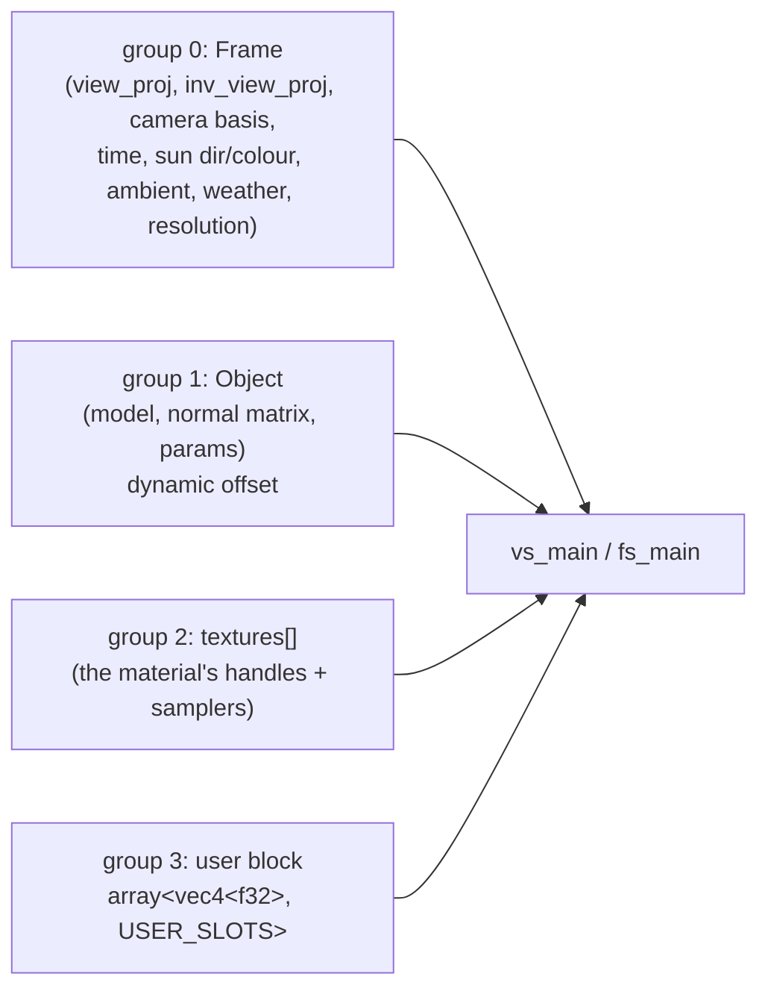

# The shader seam

The engine's renderer is a fixed metallic/roughness PBR forward pass. A ported
game sometimes needs a look the engine does not ship: goats wants a **volumetric
day/night sky**, a **vertex-coloured terrain**, and a **translucent water**
surface ([`.notes/goats.md`](goats.md), "The shader seam"). Rather than add each
as an engine feature, the engine gains **one seam**: a plugin supplies WGSL and
*values*, the engine owns every layout and binding. This note is the contract for
that seam.

It is deliberately narrow. The seam is not "bring your own pipeline"; a plugin
cannot define a bind-group layout, a vertex layout, or a render pass. It writes
two entry points against a **fixed** interface the engine generates, and it sets
numbers and texture handles. That is what makes it safe to expose — a shader is
data, not engine control flow.

**Shipped:** the assets (`ecs::assets::Shader` / `ShaderMaterial`), the two
components (`ShaderMeshRenderer` / `ScreenShaderMaterial`) with their scene
serialization, the WGSL prelude generator (`render::shader`), the extraction
stages (`render::draw_list`), and the GPU pipelines and bind groups drawn by the
frame (`render::gpu::shader_seam`) — validated by a GPU test that renders a screen
pass. The seam's first consumer is the goats sky (`examples/goats`), whose sun and
colour animate through the **dynamic user block** (written in place, no rebuild).
Both forms are now drawn by a real consumer: the goats sky (screen) and the water
surface (mesh). **Not yet:** water reflections and the bang's fire/light. (The
terrain uses the engine's vertex colour, not the seam.) The two components remain
out of `ComponentKind::ALL` for now.

## What the seam is

Three pieces:

- **`Shader`** — a WGSL source plus its `vs_main` / `fs_main` entry-point names,
  against the engine's prelude (below).
- **`ShaderMaterial`** — a `Shader` handle, an ordered list of texture handles,
  a block of `f32` uniforms, an alpha mode and a cull flag. For a mesh.
- **`ScreenShaderMaterial`** — the same, but the shader runs as a **full-screen
  fragment pass** over the render target *before* the scene draws. This is what a
  sky is: a colour computed per pixel from the camera basis, time, sun and
  weather, with no geometry.

and two components that carry them on an entity:

- **`ShaderMeshRenderer`** — `{ mesh: AssetHandle<Mesh>, material:
  AssetHandle<ShaderMaterial>, cast_shadows, receive_shadows }`, the custom-shader
  twin of `MeshRenderer`.
- **`ScreenShaderMaterial`** — the pass, on a camera or on its own entity.

The seam is the same shape as `screen_text` and `FrameImage`: the engine owns the
interface, the consumer supplies content.

## The bind-group contract

The engine defines every binding. A custom shader may *read* them and nothing
else; it never declares `@group`/`@binding` itself — the prelude does. Four
groups:

- **Frame** (`group 0`, binding 0) is the existing [`FrameUniform`] extended with
  the fields a sky wants: `time`, `sun_direction`, `sun_colour`, `weather`
  (rain / cloudiness / wind), and the camera's world basis columns. A mesh shader
  ignores what it does not use.
- **Object** (`group 1`, binding 0) is the existing [`ObjectUniform`], bound with
  a dynamic offset — the same slot the PBR pass uses, so the extra cost is zero.
- **Textures** (`group 2`): one `texture_2d` binding per slot, `0..TEXTURE_SLOTS`
  (engine-fixed at 8 — binding arrays are not universal, and the count must stay
  under the per-stage sampled-texture limit), plus a single shared
  `sampler` at binding `TEXTURE_SLOTS`; the first `material.textures.len()` are
  valid. The prelude declares the count as a const so a loop bound is not a
  runtime value.
- **User block** (`group 3`, binding 0): `array<vec4<f32>, USER_SLOTS>` mapped
  from `material.uniforms`. Fixed capacity (64 slots), so the layout never
  changes; a shader reads `user[i].x` and so on. This is how a plugin passes its
  own knobs without inventing a layout.

Because the layouts are engine-fixed, the seam has one pipeline layout per form
(mesh, screen), created once, and any `Shader` shares it.

## The WGSL prelude

WGSL has no `#include`. The engine **prepends** a generated prelude to a
`Shader`'s source: the `Vertex` input struct, the `Frame` / `Object` / `user`
bindings, the texture array, and the constants (`TEXTURE_SLOTS`, `USER_SLOTS`).
A plugin writes only its varyings, `vs_main`, and `fs_main`. So the contract is:
*declare no bindings and no `@group`; name your entry points; read the prelude.*

This is why the seam is safe: the plugin's WGSL is compiled against a header the
plugin cannot change.

## The passes

- **Screen** (the sky): a full-screen triangle, the engine supplies
  `vs_fullscreen` (or the shader provides its own `vs_main`); `fs_main` runs over
  the whole HDR target and returns `vec4<f32>` in linear HDR. It draws **first**,
  depth-write off, before the opaque pass, so the scene composites over it. A sky
  that must be visible through fog reads the camera basis from `Frame`.
- **Mesh**: a normal forward draw into the HDR target, sharing the mesh vertex
  layout, the depth buffer, and the object dynamic-offset ring with the PBR pass.
  Alpha mode chooses the blend/depth state exactly as `Material` does.

Both run inside the existing HDR→tonemap→present frame; the seam adds no pass of
its own, only draw items to the ones that exist.

## Extraction and the draw list

`extract_draw_list` (`render::draw_list`) grows two ordered stages: screen
materials first (back to front by camera priority, they clear the target with
their own colour), then `ShaderMeshRenderer` entities alongside the PBR items,
sorted by the same key and culled by the same frustum. A `ShaderMeshRenderer`
inherits the entity's `GlobalTransform` and `Visible`/`Active` exactly as
`MeshRenderer` does; an entity with both is `ShaderMeshRenderer`-wins (authoring
error).

## What this buys, concretely

With the seam in place, the goats presentation layer (M5) is ordinary work on top
of it, in the order goats.md gives:

1. **sky** — one `ScreenShaderMaterial` reading camera basis, time, sun, weather;
2. **terrain** — one `ShaderMaterial`: vertex-coloured, lit, sampling the sun and
   IBL exactly as the PBR pass does (the prelude exposes the same inputs);
3. **water** — one translucent `ShaderMaterial` over the water table's plane.

Reflections (sky/ground/mirror) are a later tier and need render targets the
seam does not provide yet — see goats.md's capability map.

## Tests

- `ecs`: the assets and their `Assets` stores — defaults, round-trip, registry
  `len`, the user-block capacity.
- `render`: the prelude generator (a pure function) and the extraction order —
  both GPU-free, so they run in CI without an adapter.
- GPU: the pipelines compile the prelude + a trivial shader, and a screen pass
  writes the expected clear — behind the existing `NoAdapter` skip.

## Open questions

- **User-block granularity.** One `vec4`-array block is the simplest fixed
  layout; a typed struct per shader would read better but would let a plugin
  shape a layout. Stay with the array unless it proves painful.
- **Screen-pass count.** One screen pass (the sky) is the known need. If two ever
  want the target, the seam takes an explicit order rather than "last wins".
- **The prelude's surface.** It will grow as terrain and water need more of the
  PBR inputs (IBL samples, the shadow map). The seam should expose the *existing*
  PBR bindings rather than a parallel set, so a custom shader lights like the
  engine's does.
- **Whether the sky is a shader or an engine feature.** A volumetric sky this
  specific could ship as an engine pass; the seam is the smaller, more general
  cost and is what goats.md decided.
