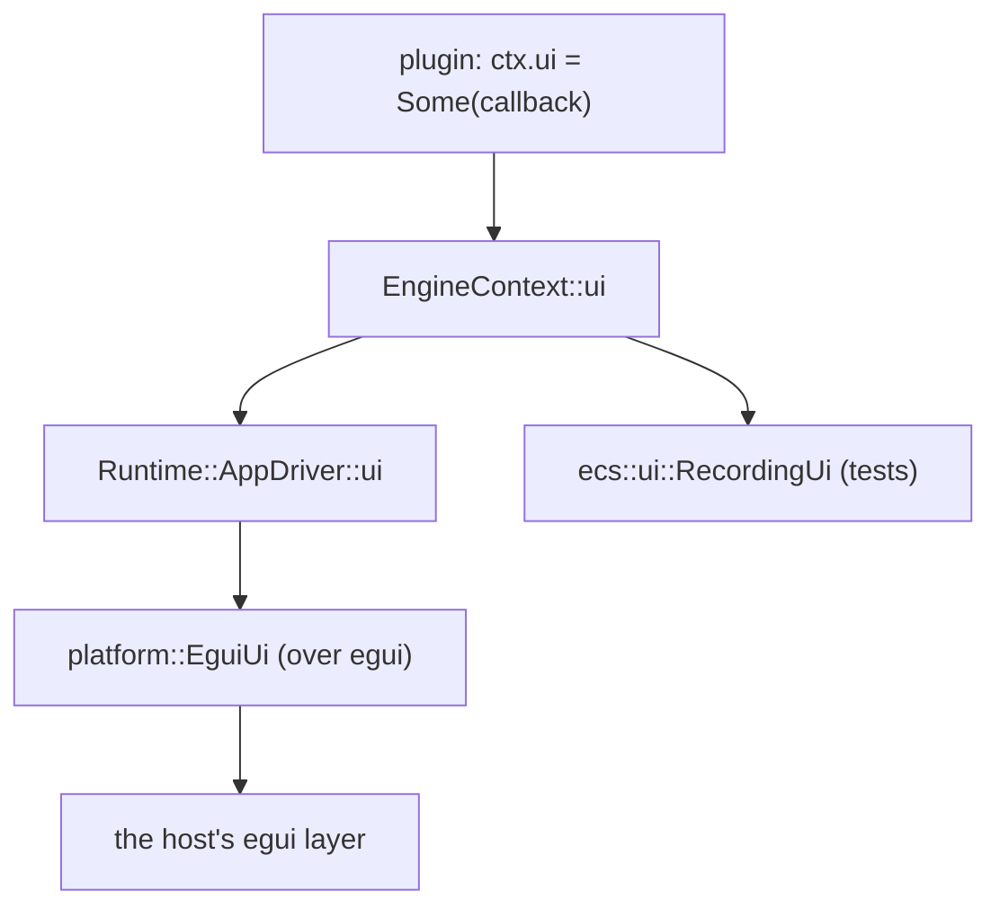

# The screen-UI seam

A plugin owns the simulation but not the window, so it cannot draw egui itself —
only an `AppDriver` (the runtime, the editor) is handed the host's egui layer.
This note is the contract for the seam that lets a *plugin* draw a menu: the
engine owns the interface, the host renders it. It is the shape `screen_text`
and `FrameImage` already use, and it is what the goats port's menus need
([`.notes/goats.md`](goats.md), M6).

## What it is

`ecs::ui` defines an egui-free [`Ui`](../crates/ecs/src/ui.rs) trait with the
handful of widgets a game menu needs, and `EngineContext::ui` holds an optional
[`UiCallback`] a plugin installs. Each frame the host, when it has a UI layer,
calls that callback with its own `Ui` — so a plugin draws a widget without ever
naming egui.

- **The trait lives in `ecs`** (widgets only: `panel`, `label`, `separator`,
  `button`, `toggle`, `slider`, `combo`, `text_field`). `ecs` never depends on
  egui.
- **The implementation lives in `platform`** (`EguiUi`, `platform::EguiUi`), the
  crate that owns egui. It wraps an `egui::Ui` and implements the trait over it.
- **The runtime bridges them**: `Runtime`'s `AppDriver::ui` draws the published
  `screen_text` lines, then wraps its `egui::Ui` in `EguiUi` and calls
  `ctx.ui`.
- **`RecordingUi`** (also in `ecs::ui`) records calls and answers scripted
  presses, so a headless test drives a menu with no window and no egui.

## Why the trait is in `ecs` and not `platform`

`platform` depends on `ecs` (`platform <- runtime`), never the reverse. A plugin
is a `noctis` consumer and may depend on `ecs` alone; if the trait lived in
`platform`, a plugin would have to depend on the window host to name a widget.
Keeping the trait in `ecs` and the egui glue in `platform` is the same split as
the shader seam (the contract in `ecs`, the renderer behind it).

## The shape



## Using it

A plugin sets `ctx.ui` from one of its systems each frame, the way it publishes
`screen_text`. Because the callback is `'static` and owns its state, a plugin
that must reach gameplay state shares it: it holds the UI state (which screen is
open, the settings the panels edit, and a queue of commands the panels asked
for) behind an `Rc<RefCell<..>>` shared between the update system and the
callback, and the update system applies the drained commands to the world.

```rust
// In a plugin's update system, with the UI state shared as `Rc<RefCell<Menus>>`:
let menus = Rc::clone(&self.menus);
ctx.ui = Some(Box::new(move |ui| {
    menus.borrow_mut().draw(ui);
}));
```

The host calls the callback *after* the frame's systems have run (the UI is
drawn, and its interactions read, once the world has moved), and only when a UI
layer exists — a headless run draws no plugin UI.

## What it deliberately is not

- **Not a widget toolkit.** Eight widgets, immediate mode, no layout beyond
  vertical stacking and a nested panel. A consumer that wants more uses egui
  directly by being an `AppDriver`; a plugin gets exactly what a game menu needs.
- **Not a retained tree.** No widget ids to manage beyond the `id`/label strings
  a panel or field needs to tell two otherwise-identical widgets apart.
- **Not a data-binding layer.** A widget edits the `&mut` it is handed; sharing
  that value with the simulation is the plugin's business (`Rc<RefCell<..>>`, or
  a command queue drained by the update system).

## Testing

The seam is headlessly testable on both sides:

- `ecs`: `RecordingUi` records the calls and answers `press`ed widgets, so a
  menu's structure and its click handling are unit-tested with no window.
- `runtime`: an integration test (`crates/runtime/tests/ui.rs`) runs a real egui
  frame (`egui::Context::run_ui`) with a plugin callback installed and asserts it
  painted shapes — the same technique `tests/hud.rs` uses for `screen_text`.

## Follow-ups

- The web host draws no egui overlay yet (`platform::web`), so a browser run
  shows no plugin UI; the seam is host-agnostic and lands when the web egui path
  does ([`.notes/web.md`](web.md)).
- Rich widgets (multi-line text, tables, a scrollback list) are not in the trait;
  the goats console uses a single-line field plus `screen_text`-style output until
  one is needed.
