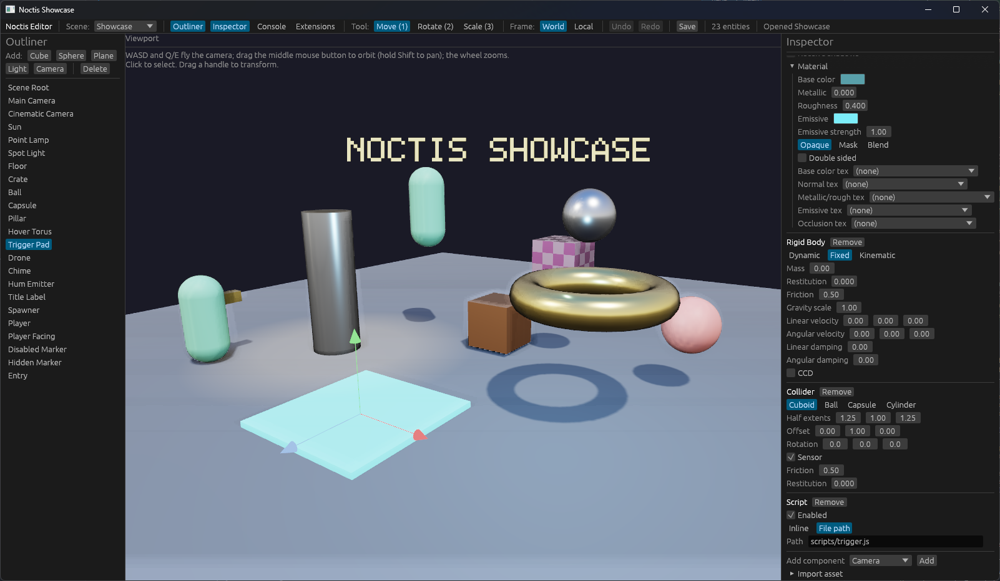

# Noctis

A 3D game engine for Windows and Linux. A [Rust](https://www.rust-lang.org)
core with a [wgpu](https://wgpu.rs) renderer, [rapier](https://rapier.rs) physics,
[rodio](https://github.com/RustAudio/rodio) audio, and scripting via the
[Slag](https://github.com/sdgoij/slag) engine (JavaScript and WebAssembly). It
ships a live editor, a project model, and a build that exports a self-contained
game — or runs it in the browser.

> **⚠ Early development — expect breakage.**
> Noctis is **not ready for production**. The APIs, the scene format and the CLI
> change between commits without notice, there are rough edges everywhere (see
> [Status](#status)), and nothing here is a stability promise. It is developed in
> the open; treat it as a moving target and pin to a commit if you build on it.

**Platforms.** Windows and Linux are supported. macOS is **not supported**: it is
untested, and a macOS binary needs Apple's SDK to link, so one cannot be built
from the maintainer's Linux toolchain.



## What is Noctis?

Noctis is a batteries-included engine for making small 3D games and tools, built
around three ideas:

- **A small, explicit core.** Everything is an ECS entity and a component. The
  engine's own `math` and `ecs` crates are a frozen contract
  ([`.notes/core-api.md`](.notes/core-api.md)) the rest is built on.
- **A real editor, not a toy.** The editor is a live viewport with an outliner,
  an inspector, click-to-select picking, a transform gizmo, undo/redo, scene
  save and switching, asset import, and an AI-controllable command API. It can
  also run **headless** to build scenes from a JSON command batch in CI.
- **Scripting and Rust, side by side.** Gameplay can be JavaScript, native
  WebAssembly, or Rust compiled into the game — a project can mix them. The
  editor itself is extended the same way (JavaScript/WebAssembly extensions).

It is a general engine (rendering, physics, audio, text, animation via glTF,
image-based lighting, soft shadows, SSAO, HDR tonemapping) with a coherent
project model, rather than a framework of unconnected parts.

## Features

- **Renderer** — physically-based materials (glTF), image-based lighting from an
  `.hdr` environment, soft shadows, SSAO, HDR tonemapping, MSAA, billboarded
  in-world text, and an editor gizmo pass.
- **Physics** — [rapier3d](https://rapier.rs) bodies, colliders, sensors, and
  kinematic characters; scripts can drive bodies and query grounding/overlaps.
- **Audio** — [rodio](https://github.com/RustAudio/rodio) playback with 3D
  spatialization, and a WebAudio backend on `wasm32`.
- **Scripting** — JavaScript and native WebAssembly through Slag, with component
  reflection, scene switching, portals, and a documented import ABI.
- **Projects** — a `noctis.toml` manifest, canonical asset paths, automatic
  import (glTF, textures, HDR, audio, fonts, scripts), prefabs, and build targets.
- **Editor** — outliner, inspector (every component, with asset pickers and an
  in-place material editor), gizmo, picking, undo/redo, prefab library, scene
  picker, and extension panels.
- **Build & export** — a self-contained game folder, or a browser build
  (one wasm client that can dispatch between several projects).
- **Headless everywhere** — the whole engine runs without a GPU or a device, so
  `cargo test --workspace` is CI-friendly.

## Getting started

Noctis is built from source; there is no binary release yet. You need a recent
Rust toolchain — the repository pins one in [`rust-toolchain.toml`](rust-toolchain.toml)
(edition 2024, Rust 1.98) and `rustup` will pick it up automatically.

```sh
git clone https://github.com/sdgoij/noctis
cd noctis

# Build everything, including the game client.
cargo build --workspace

# Open the editor on the all-features test scene.
cargo run -- editor --testscene

# Open the example project (imports its assets and prefabs).
cargo run -- editor --project examples/showcase
```

Play the example project:

```sh
cargo run -- run --project examples/showcase      # windowed
cargo run -- run --project examples/showcase --headless --frames 60
```

Run the tests:

```sh
cargo test --workspace
```

The engine also ships a [`Justfile`](Justfile) that keeps the common commands in
one place:

```sh
just build          # cargo build --workspace
just check          # fmt + clippy over the whole workspace
just test           # check, then test
just run examples/showcase
just publish-wasm   # build the browser demos into docs/ for GitHub Pages
```

See the [command reference](#command-reference) for the full `noctis` CLI, and
[`AGENTS.md`](AGENTS.md) for how the repository is organised and tested.

## Scripting

Gameplay lives in scripts and Rust. Which you reach for is a project decision —
the three options interoperate.

### JavaScript (default)

Scripts are JavaScript, run by the embedded [Slag](https://github.com/sdgoij/slag)
engine, which is always built. Drop a `.js` file in a project's `scripts/` and
attach it: no build step, and the dev client hot-reloads an edited script.

```js
function on_start(entity, dt) {}   // once, when the script first runs
function on_update(entity, dt) {}  // every frame
function on_destroy(entity, dt) {} // when the entity is removed

function on_update(entity, dt) {
  const p = get_position(entity);           // arrays, not strings
  translate(entity, 0, Math.sin(time_elapsed()) * dt, 0);
  if (key_down("Space")) { add_velocity(entity, 0, 5.0, 0); }
}
```

The API covers transforms, spawning and destroying, name lookup, key/pointer
input, driving dynamic bodies, physics reads, component reflection
(`get_component`/`set_component` by name — a Rust custom component or a built-in),
prefabs, and scene switching/portals. See
[`examples/showcase/README.md`](examples/showcase/README.md).

### Native WebAssembly

A `.wasm` module is a first-class script alongside a `.js` one. It imports the
engine API from a module named `noctis` (transforms read/write, spawn, reflection
over linear memory, and so on) and exports `on_start`/`on_update`/`on_destroy`;
the import ABI is documented in
[`crates/script/src/wasm_host.rs`](crates/script/src/wasm_host.rs). Register one
with `noctis run --wasm <name>=<path>`, or reference it by path like any script
asset.

> Note: compiling a `.wasm` script by hand is possible but not yet pleasant — a
> first-class toolchain story is on the roadmap.

### Rust (a project plugin)

When gameplay wants Rust's speed or the engine's own types, a project can carry a
Rust plugin: put a `Cargo.toml` at the project root and mark the plugin **type**
`#[noctis::plugin]`, which exports the `noctis_plugin` symbol the tool links.
Implementing `Plugin` for it registers the project's custom components and
systems. `noctis run` and `noctis editor` generate and link a per-project tool;
`noctis build` links it into the shipped client. See
[`examples/rustball`](examples/rustball) for a worked example (a custom component,
a fly-camera system, and a simulated ball) and
[`.notes/embedding.md`](.notes/embedding.md) for the design.

### Editor extensions

The editor is extended with **JavaScript or WebAssembly extensions** — no
rebuild. An extension is a directory with an `extension.json` and an
`extension.js`/`extension.wasm`, discovered by `noctis editor`; it talks to the
editor through a versioned `noctis` global with `on` (events), `command` (verbs),
`edit` (an `EditorCommand` batch, one undo step), `editor`/`ui` (reads and
panels). See [`examples/extensions`](examples/extensions) and
[`.notes/extensions.md`](.notes/extensions.md).

## Projects

A **project** is a directory with a `noctis.toml` manifest. It owns one shared
asset registry, zero or more scenes, prefabs, and scripts, and defines the
project's build targets. The full design is [`.notes/project.md`](.notes/project.md).

```
mygame/
  noctis.toml           # the manifest (required)
  assets/
    models/             #   .glb/.gltf
    textures/           #   .png/.jpg/...
    hdris/              #   .hdr equirectangular environments (image-based lighting)
    audio/              #   .wav/.ogg/.mp3
    fonts/              #   .ttf/.otf
  scenes/               #   *.scene.json
  prefabs/              #   *.prefab.json
  scripts/              #   *.js / *.wasm
  .noctis/              #   GENERATED cache — add to .gitignore
```

These directories are conventions, overridable with `[paths]`. Assets are
referenced by their **project-relative path** (the form written into scenes), and
a glTF sub-asset is addressable as `assets/models/robot.glb#mesh/Torso`.

A minimal manifest:

```toml
[project]
name = "MyGame"

[project.settings]
default_scene = "scenes/main.scene.json"
mode = "3d"                       # default for new scenes; a scene may override
gravity = [0.0, -9.81, 0.0]

[window]
title = "MyGame"
width = 1280
height = 720
```

`noctis.toml` is parsed strictly — an unknown key is an error, not silent forward
compatibility. `[[build]]` targets and an optional `[[scene]]` list (names and
order) are also supported; see `.notes/project.md`.

### The workflow

```sh
# 1. Author: open the project, import its assets, edit a scene, save it back.
cargo run -- editor --project mygame                         # interactive
cargo run -- editor --project mygame --headless \
    --command '[{ "op": "spawn", "name": "Box" }]' --out mygame/scenes/main.scene.json

# 2. Run: import the project's assets and play its default scene.
cargo run -- run --project mygame

# 3. Build: export a self-contained, distributable game folder.
cargo run -- build --project mygame
```

With `--project <dir>` the editor and the runtime import every asset file into one
registry, make `--scene` project-relative, and use the project's `default_scene`
when `--scene` is omitted. `--scene` on its own still works for a loose,
self-contained scene file.

**Assets** are imported automatically on open: models (glTF), textures, HDR
environments (`.hdr`), audio (WAV/Ogg/MP3), fonts, and scripts. A file that fails
to import is reported as a warning and does not stop the project opening; a
*scene* that references a missing asset is a load error naming the path. Texture
decoding is cached under `.noctis/` (add that directory to your `.gitignore`).
Per-asset settings live in a sidecar next to the file, for example
`assets/textures/wood.png.import.toml`:

```toml
srgb = false     # a data map (normal/roughness); omit for colour maps
```

**Image-based lighting** comes from an HDR environment the manifest names:

```toml
[render]
environment = "assets/hdris/sky.hdr"   # equirectangular; omit for a neutral env
sample_count = 4                       # MSAA samples (1 disables); clamped to the device
```

**Prefabs** live in the project as `prefabs/<name>.prefab.json`. The editor loads
them on open (so `instantiate_prefab` resolves them) and `--save-prefabs` writes
the edited library back.

### Scenes and 2D / 3D (`--mode`)

There is one scene format; a scene carries a `mode` of `"2d"` or `"3d"` (a
presentation hint, not a schema fork). A project's `mode` is the default for new
scenes, and a scene may override it.

```sh
# Create / open a 2D scene; in a 2D scene the editor adds an orthographic camera.
cargo run -- editor --headless --scene menu.scene.json --mode 2d --out menu.scene.json
```

An existing scene keeps the mode stored in its file; `--mode` only applies when a
scene is created from scratch.

### Building and exporting

```sh
# Export the project's default scene (or --scene) to dist/.
cargo run -- build --project mygame

# Build a named [[build]] target, or override the output.
cargo run -- build --project mygame --target release
cargo run -- build --project mygame --out dist/demo --name demo
```

A build writes a self-contained folder: the `noctis-game` client (built on demand
when missing), `scene.json`, every asset the scene references (resolved
transitively through the import index), a generated `noctis.toml`, and
`noctis-game.json`. Running the exported executable with no arguments loads its
bundled scene. A `[[build]]` target looks like:

```toml
[[build]]
name = "mygame"
scene = "scenes/main.scene.json"  # defaults to project.settings.default_scene
output = "dist/mygame"            # optional; default is dist/<profile>/
platform = "host"                 # "host" | "windows" | "macos" | "linux" | "wasm"
profile = "release"               # "dev" | "release"
```

The **profile** decides how scripts travel (see [`.notes/scripts.md`](.notes/scripts.md)):
a `release` build bakes the project's `.js`/`.wasm` into the client (self-contained,
no `scripts/` directory); a `dev` build runs the project in place and hot-reloads
an edited script. Output is organised as `dist/release/` and `dist/dev/` so the
two never overwrite each other.

A **wasm** platform builds a browser client instead: a wasm module (with each
project's Rust plugin linked in, chosen at boot) plus a `<name>.zip` per project
and a generated `index.html`. `--project` may repeat, so several projects share
one client (see [`.notes/web.md`](.notes/web.md)):

```sh
# The demo site: one client that runs either project.
cargo run -- build --platform wasm \
    --project examples/showcase --project examples/rustball --out docs
```

### Command reference

`noctis` is one binary; each capability is a subcommand:

```
noctis editor [OPTIONS]     open the editor, or build scenes from JSON
noctis run    [OPTIONS]     run a scene or game (a window by default)
noctis build  [OPTIONS]     build a project into a game folder
noctis rename [OPTIONS]     move an asset and rewrite its references
```

`noctis editor`:

```
--scene <PATH>     open or create a scene (project-relative with --project)
--project <DIR>    open a project; imports its assets and prefabs
--mode <2d|3d>     presentation mode for a scene created from scratch
--command <SRC>    apply a JSON command batch (file, `-` for stdin, or inline)
--out <PATH>       save the resulting scene
--headless         do not open a window (implied by --command/--out/--print-schema)
--testscene        load the engine's all-features scene
--save-prefabs     write the prefab library to the project's prefabs/
--controls <PATH>  camera-navigation bindings (JSON)
--print-schema     print the JSON command schema
```

`noctis run`:

```
--scene <PATH>     run a scene JSON (project-relative with --project)
--project <DIR>    open a project; the default scene runs when --scene is omitted
--target <NAME>    export a named [[build]] target
--demo             run a small built-in scene
--headless         run --frames frames and exit (default: open a window)
--frames <N>       frames to run headlessly (default 300)
--render           render each frame with a headless GPU (skipped if unavailable)
--export <DIR>     export a self-contained game folder
--name <NAME>      exported executable name
--wasm <name>=<path>   register a .wasm script
--no-audio         do not open an audio device
--print-summary / --quiet
```

## Examples

- [`examples/showcase`](examples/showcase) — a complete project: scenes, prefabs,
  scripts, animation, portals, and a third-person controller. It exercises every
  engine feature and is the end-to-end test spine.
- [`examples/rustball`](examples/rustball) — a project whose gameplay is **Rust**
  (a plugin type marked `#[noctis::plugin]`, with a custom component and systems),
  not a script.
- [`examples/extensions`](examples/extensions) — a worked editor extension (a
  `scatter` verb, a panel, and an `EditorCommand` batch).

## Contributing

Contributions are welcome — **issues and pull requests are open**. This is an
early-stage project, so a quick conversation in an issue before a large change is
the surest way to land it.

Before you open a PR:

1. **Install the pre-commit hook** (once per clone). It blocks commits whose code
   fails `cargo fmt --check` or `cargo clippy --workspace --all-targets -- -D warnings`:

   ```sh
   git config core.hooksPath hooks
   ```

2. **Make it green.** `cargo test --workspace` must pass (or `just test`, which
   runs the checks first). GPU and audio tests skip gracefully when no device is
   present, so this works on a headless machine.

3. **Match the house style.** `#![forbid(unsafe_code)]` everywhere; modules carry
   `//!` docs and public items `///` docs; no panics on runtime paths (prefer
   `Result`/`Option`); and **tests are the product** — a module with logic has
   tests, and the `testscene`/`showcase` spines must stay covered.

4. **Write the commit message well.** A subject under ~50 characters, imperative,
   with a `type:` prefix (`feat:`, `fix:`, `test:`, `docs:`, `perf:`, `build:`),
   and a body that says *what* and *why* (grouped by crate where it helps). See
   the git history for the shape.

The full guide — workspace layout, the component checklist, and the testing
doctrine — is [`AGENTS.md`](AGENTS.md).

## Status

All crates are implemented and tested (`cargo test --workspace` is green), the
renderer presents to a real window (a window is the default; `--headless` opts
out), and the editor draws an [egui](https://github.com/emilk/egui) interface over
a live viewport. It is nonetheless **early**: formats and APIs move, some systems
are deliberately partial, and the limitation list lives in
[`AGENTS.md`](AGENTS.md) ("Known limitations — tracked, not hidden") rather than
being hidden here. Feedback and bug reports are exactly what this stage needs.

## Further reading

- [`spec.md`](spec.md) — the design goals.
- [`AGENTS.md`](AGENTS.md) — the contributor guide: workspace layout, the
  component checklist, the testing doctrine, and the known limitations.
- [`.notes/`](.notes) — the design contracts (core API, project model, embedding,
  web, extensions, scripting, portals), treated as part of the code.
- [`examples/showcase`](examples/showcase) — the end-to-end example and test spine.

## License

Licensed under either of [Apache License, Version 2.0](LICENSE.md) or
[MIT license](LICENSE.md), at your option — both texts are in
[`LICENSE.md`](LICENSE.md).

Unless you explicitly state otherwise, any contribution intentionally submitted
for inclusion in this project by you shall be dual licensed as above, without any
additional terms or conditions.
